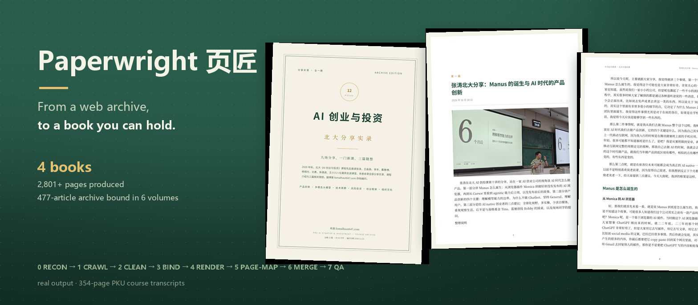
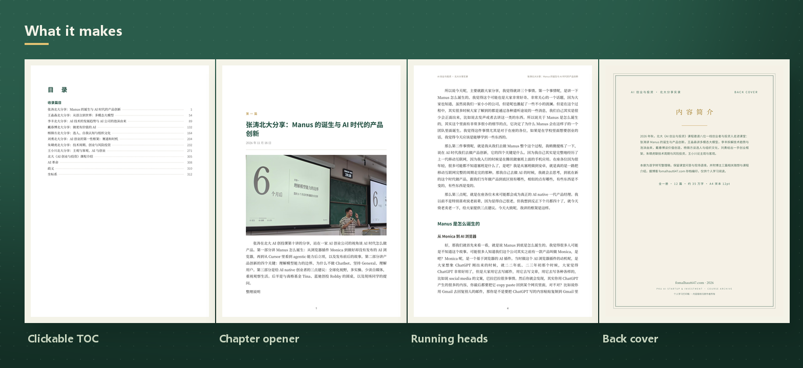
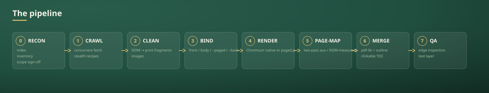

<p align="right"><strong>English</strong> · <a href="README.zh-CN.md">简体中文</a></p>

<p align="center">
  <a href="assets/hero.png"></a>
</p>

<h1 align="center">Paperwright 页匠</h1>

<p align="center">
  <strong>Bind web content into print-grade books.</strong><br>
  Crawl → clean → bind → render → two-pass page numbers → merge & QA — an agent skill + production pipeline.<br>
  Distilled from four real book runs: 430 pp · 393 pp · 6 volumes / 2,801 pp · 354 pp.
</p>

<p align="center">
  <a href="LICENSE"></a>
  
  
  
</p>

---

## What it makes

Every image below is a real page from a real book produced by this pipeline — not a mockup.

<p align="center">
  <a href="assets/pages.png"></a>
</p>

| | |
|---|---|
| **Cover & back cover** | light paper-frame system (dark full-bleed covers are a known print defect — ink flooding, banding, no-bleed edges) |
| **Clickable TOC** | two-pass page numbers, verified `[links]`; Chromium silently drops cross-document anchors, so links are re-inserted with fitz after merging |
| **Chapter opener** | piece number, hero photo, breathing room |
| **Running heads** | book title left, chapter title right, headerless openers — via paged.js margin boxes |

## The pipeline

<p align="center">
  
</p>

The part most tools skip is **0 and 7**: editorial decisions (scope, language, images, ordering, volume split, title) are asked up front and a sample volume ships before mass production; and QA is not a green checkmark — pages are rendered and inspected edge by edge, and the text layer is verified line by line.

## Why not just "print to PDF"?

Browsers print documents. Books are a *system*: asymmetric margins that survive binding, running heads that tell you where you are, footnotes and figures with their own conventions, a back cover. This pipeline implements that system — and its [pitfall ledger](references/pitfalls.md) (16 entries) records what breaks in real printing: ink-flooded covers, hidden link annotations, cross-document anchor loss, `box-sizing` frame overflow, shingle fingerprints that miss edited reprints.

## Book-grade CJK typography

| Element | Spec |
|---|---|
| Body | 12pt / **1.85 line-height / 0.6em paragraph spacing** (indent-only "textbook style" rejected by real readers) |
| Chapter opener | 28mm headroom, piece-number kicker, 22pt title |
| Section heads | 15pt / 12.5pt — never flush against body size |
| Figures | numbered, captioned from alt text |
| Extras | justified, `orphans/widows: 2`, back cover, per-book print spec sheet |

Full scale + rationale: [references/typography.md](references/typography.md)

## Quick start

```bash
# prerequisites
npm install -g playwright pdf-lib && npx playwright install chromium
pip install pymupdf beautifulsoup4 pillow
export PW_FONT_DIR=/path/to/@fontsource-node_modules   # noto-sans-sc / noto-serif-sc / jetbrains-mono

# build (project dir with crawl/ + plan.json)
cp -r templates scripts
python scripts/build_fragments.py                       # adapt ★-marked points per site
node scripts/build.mjs --paged --out body               # paged.js pro mode
node scripts/print-paged.cjs output/body-paged.html --pagemap-out pagemap.json
node scripts/build.mjs --front --pagemap pagemap.json --out front
node scripts/print.cjs output/front.html --margin0
node scripts/build.mjs --back --out back && node scripts/print.cjs output/back.html --margin0
node scripts/assemble.cjs output/front-paged.pdf output/body-paged.pdf book.pdf "Book Title" output/back.pdf --keep-last
python scripts/postprocess.py book.pdf --front output/front-paged.pdf --plan plan.json \
       --pagemap output/pagemap.json --title "Book Title" --author "Source" --subject "Subject" --keywords "a,b"
```

Native (non-paged) mode: drop `--paged`, render the body with `print.cjs`, run `pagemap.py`, merge without `--keep-last`.

## Using as an agent skill

`SKILL.md` follows the open [Agent Skills](https://agentskills.dev) format — point any skill-capable agent (ZCode, Claude Code, …) at this directory and it registers on intents like "把这些文章做成书 / 出印刷版 / 装订成册".

The skill bakes in a hard workflow rule: **recon first, report the inventory, get explicit sign-off on scope/language/ordering/volume split, ship a sample volume before mass production.** The tool doesn't decide what goes into someone's book.

## Repository map

```
SKILL.md                 agent entry: decision checklist + 8-phase overview
references/
  pipeline.md            the 8 phases with commands
  pitfalls.md            16 earned-the-hard-way failure modes
  cleaning.md            DOM cleaning, link policies, dedup methodology, fetch configs
  cover-systems.md       light paper-frame default + dark system on request
  typography.md          the type scale and its rationale
templates/               production scripts with ★ adaptation markers
examples/                notes from real production runs
assets/                  hero & sample images, generator script
```

## Production runs

| Run | Content | Result |
|---|---|---|
| Enterprise whitepaper | open-source docs site | 430 pp, single volume |
| Technical monograph | mkdocs-based book | 393 pp, single volume |
| Article archive (产品沉思录) | 477 articles + archives + external sources | 6 volumes, 2,801 pp |
| PKU course transcripts | 12 lecture transcripts, ~350k chars | 354 pp, single volume |

## License

[MIT](LICENSE). Bundled dependencies keep their own licenses: [Paged.js](https://pagedjs.org) (MIT), [Source Han fonts via @fontsource](https://github.com/fontsource) (OFL).

<p align="right"><a href="#top">↑ top</a></p>
