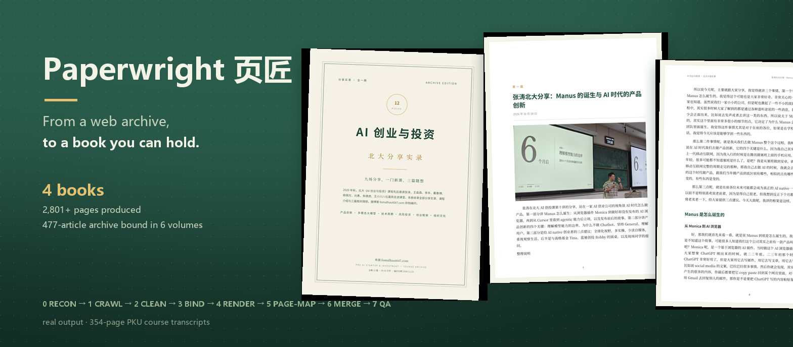
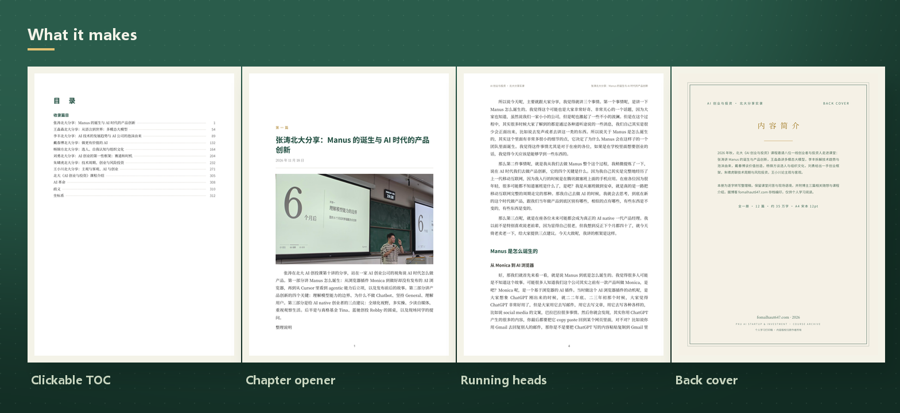
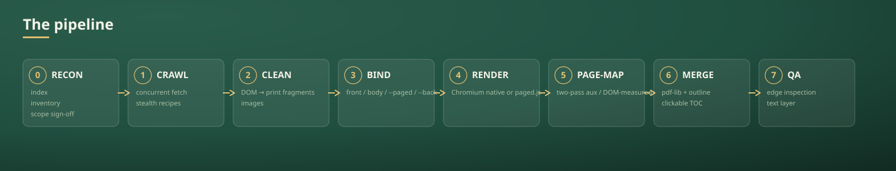

<p align="right"><a href="README.md">English</a> · <strong>简体中文</strong></p>

<p align="center">
  <a href="assets/hero.png"></a>
</p>

<h1 align="center">Paperwright 页匠</h1>

<p align="center">
  <strong>把网页内容装订成出版级的书。</strong><br>
  爬取 → 清洗 → 装订 → 渲染 → 两遍法页码 → 合订与验收——一套 agent skill＋生产管线。<br>
  四次真实出书沉淀：430 页 · 393 页 · 六卷 2,801 页 · 354 页。
</p>

<p align="center">
  <a href="LICENSE"></a>
  
  
  
</p>

---

## 它做出来的东西长什么样

下面每一页都是这条产线真实做出来的书页，不是示意图。

<p align="center">
  <a href="assets/pages.png"></a>
</p>

| | |
|---|---|
| **封面与封底** | 浅色纸面细框系统（深色满版是已知印刷缺陷——覆墨/条纹/打不出出血边） |
| **可点击目录** | 两遍法页码；Chromium 会静默丢弃跨文档锚点，合订后用 fitz 重插真实 GoTo 链接 |
| **章扉** | 篇序＋hero 照片＋呼吸留白 |
| **页眉双联** | 左书名右篇名、章扉免页眉——paged.js margin box 实现 |

## 产线

<p align="center">
  
</p>

多数工具跳过的是 **第 0 和第 7 阶段**：收录范围、语种、图片、排序、分卷、书名先问清，先交样册再铺全量；验收不是打个绿勾——书页渲染出来逐页看四边，文本层逐行验证。

## 为什么不是"打印成 PDF"

浏览器打印的是文档。书是一套**制度**：能扛住装订的不对称版心、告诉你读到哪里的页眉、图和注的规矩、封底。这条产线把制度做成了代码——[坑账](references/pitfalls.md)（16 条）记录了实物打印里真实翻过的车：覆墨封面、链接注记消失、跨文档锚点丢失、box-sizing 框架溢出、shingle 指纹抓不住精编 reprint。

## 书级中文排印

| 元素 | 规格 |
|---|---|
| 正文 | 12pt ／ **行距 1.85 ／ 段距 0.6em**（纯缩进的"课本式"被真实读者否决） |
| 章扉 | 28mm 顶部留白＋篇序 kicker＋22pt 篇题 |
| 节标题 | 15pt / 12.5pt——严禁贴着正文 |
| 图 | 编号＋按 alt 出图注 |
| 其他 | 两端对齐、`orphans/widows:2`、封底、随书打印说明书 |

完整字号阶梯与依据：[references/typography.md](references/typography.md)

## 快速开始

见 [README.md#quick-start](README.md#quick-start)。需要：Node（playwright、pdf-lib 全局）、Python（pymupdf、beautifulsoup4、pillow）、思源黑宋字体（@fontsource）。

## 作为 agent skill 使用

`SKILL.md` 遵循开放 [Agent Skills](https://agentskills.dev) 格式——任何支持 skill 的 agent（ZCode、Claude Code 等）指向本目录即自动注册，触发意图如"把这些文章做成书 / 出印刷版 / 装订成册"。

skill 内建硬规矩：**先摸底、报清单、拿到范围/语种/排序/分卷的明确批准、先交样册再铺全量**——收进用户书里的东西，工具说了不算。

## 仓库地图

```
SKILL.md                 agent 入口：决策清单＋八阶段速览
references/              管线 / 坑账 16 条 / 清洗配方 / 封面系统 / 字号阶梯
templates/               13 件产线脚本（★ 标注改装点）
examples/                三次真实出书的产线笔记
assets/                  hero 与样张图＋生成脚本
```

## 真实出书记录

| 战役 | 内容 | 成书 |
|---|---|---|
| 企业白皮书 | 开源文档站 | 430 页 · 全一册 |
| 技术专著 | mkdocs 书 | 393 页 · 全一册 |
| 产品沉思录存档 | 477 篇正文＋存档＋站外原文 | 6 卷 · 2,801 页 |
| 北大课程实录 | 12 篇逐字转写，约 35 万字 | 354 页 · 全一册 |

## 协议

[MIT](LICENSE)。捆绑依赖保留各自协议：[Paged.js](https://pagedjs.org)（MIT）、[Source Han 字体（@fontsource）](https://github.com/fontsource)（OFL）。

<p align="right"><a href="#top">↑ 回到顶部</a></p>
